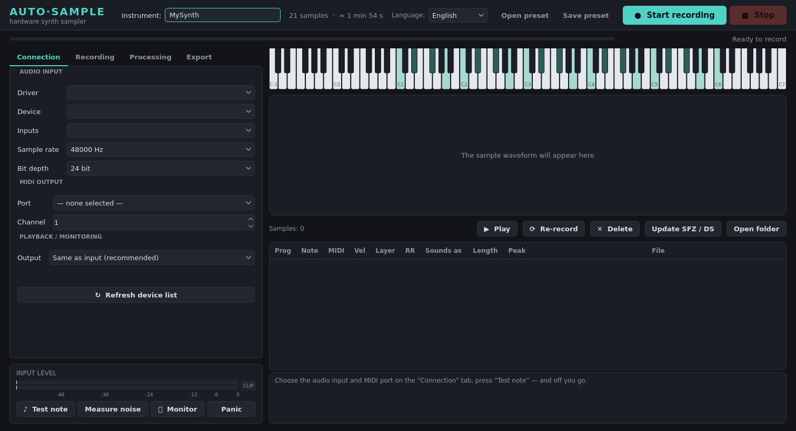

[](https://vshymanskyy.github.io/StandWithUkraine)
=========

# AutoSample

[](https://github.com/deigineor/AutoSample/actions/workflows/ci.yml)
[](https://github.com/deigineor/AutoSample/releases/latest)

Automatic sampling of hardware synthesizers: the app plays notes over MIDI, records the synth output through a sound card, processes the samples and saves a finished instrument.

## Downloads
Ready-made builds are on the [Releases](https://github.com/deigineor/AutoSample/releases/latest) page:
- **Windows** — `AutoSample-<version>-windows-x64.exe`, just run it.
- **Linux** — `AutoSample-<version>-linux-x86_64.AppImage`: `chmod +x AutoSample-*.AppImage`, then run it. Works on any distribution; needs a sound server (ALSA, JACK or PulseAudio/PipeWire).

Checksums are in the `SHA256SUMS` file next to the builds.

## Run from source
Double-click `AutoSample.bat` (on first run it creates `.venv` and installs the dependencies).
Or: `.venv\Scripts\python.exe main.py`

## Usage
Quick start:
1. **Connect** — driver (WASAPI / ASIO), audio input, MIDI port and channel. Press **Test note** — the level meter should move.
2. **Measure noise** — 1.5 s of silence; the app picks the trim thresholds itself.
3. **Record** — note range and step, velocity layers, round robin, note and tail length.
4. **●  Start recording** — and go get a coffee ☕

Full guide: [docs/usage.md](docs/usage.md).

## Features
- Note range with step, up to 16 velocity layers, up to 16 round robins
- Fixed-length tail, or "until silence" (automatic detection of the end of the release)
- Expression layers: aftertouch (Channel Pressure) or MIDI CC — a separate recording dimension, like velocity; crossfades are written to SFZ / DecentSampler
- Swell articulation: aftertouch / CC ramp during the note, saved as a separate "… Swell" instrument
- Detection of the real pitch, warning about synth transposition, root note from the real pitch
- Input monitoring and listening through the same device (works with ASIO)
- Batch recording of several programs (Program Change + Bank MSB/LSB) — each becomes a separate instrument
- Automatic trimming of silence at the start and end, fade in/out, DC removal
- Normalization: each sample separately or the whole instrument (dynamics between layers are kept)
- Automatic loop point search with crossfade
- WAV 16/24/32f with root note and loop in the smpl chunk
- Export of the mapping to **SFZ** and **DecentSampler**
- Live waveform while recording, level meter with clip indicator, on-screen keyboard (click = play the note on the synth)
- Listening to, re-recording and deleting individual samples
- English and Ukrainian interface (switch in the header)
- Presets; the last settings are saved automatically

Hotkeys: **Space** — play the sample, **Esc** — stop.

## Screenshots


## Development
```
python -m venv .venv
.venv/bin/pip install -r requirements-dev.txt     # Windows: .venv\Scripts\pip
.venv/bin/pytest -q
.venv/bin/ruff check .
```
Local build: `bash packaging/build_linux.sh` (AppImage) or `bash packaging/build_windows.sh` (exe) — the result goes to `dist/`. PyInstaller config: `packaging/autosample.spec`.

## Release
**From the browser (recommended):** Actions → **Release** → **Run workflow** (branch `main`) → choose the bump:
- `patch` — bug fixes only (1.2.3 → 1.2.4)
- `minor` — new feature, backward compatible (1.2.3 → 1.3.0)
- `major` — **only for breaking changes**: old presets/configs or workflows stop working (1.2.3 → 2.0.0)

CI bumps `__version__` in `autosample/__init__.py`, commits it to `main`, tags `vX.Y.Z`, builds Windows and Linux and publishes a GitHub Release with automatic notes, the build files and `SHA256SUMS`.

**By hand:** bump `__version__`, commit to `main`, then `git tag vX.Y.Z && git push origin vX.Y.Z` (the tag must match `__version__`). Don't create the release in the GitHub UI — CI creates it.
